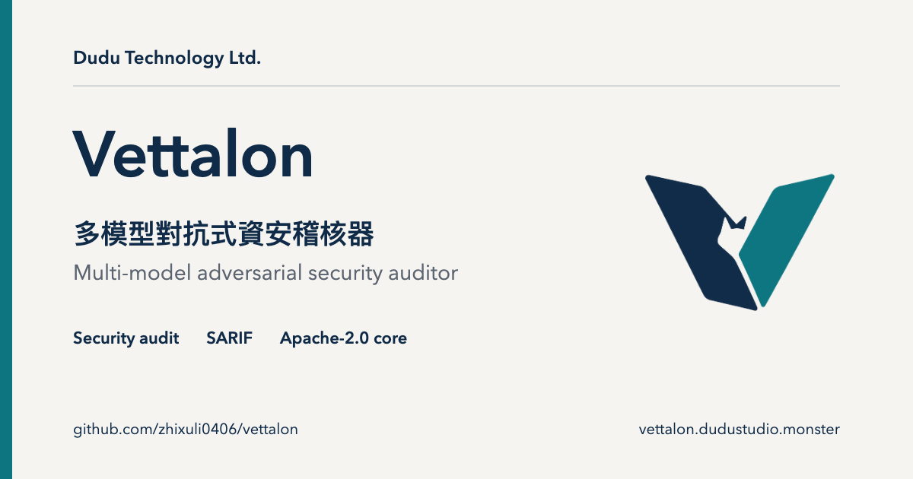

# Vettalon website

Vettalon 的雙語產品官網，介紹多模型對抗式資安稽核、實測限制、版本價格與法律政策。

本站使用 React、Vite、原生 CSS 與既有 Lucide 圖示。首頁先說明多模型交叉覆核程式碼風險，提供開源版與真實輸出兩個入口；接著以真實 WebGL 玻璃稜鏡作側邊說明，提供三個虛構程式碼案例的覆核流程互動，讓讀者切換 Finder、Verifier 與人工 Review，並展開每個階段的理由。這些案例僅供解說，不執行掃描，也不是實際產品報告或基準測試。

## 本機使用

需要 Node.js 22 或更新版本及 npm。

```sh
npm ci
npm run dev -- --host 127.0.0.1
npm run check
npm run preview -- --host 127.0.0.1 --port 18873 --strictPort
```

`check` 依序執行 ESLint、正式建置與互動狀態／SSR 檢查。`preview` 提供建置後的靜態網站；先執行 `check` 或 `build`。

正式建置會輸出繁體中文及英文首頁，並在兩種語言下各產生服務條款、隱私權政策與退款政策，共八頁。頁面保留原本的 URL、導覽錨點、SEO metadata、結構化資料及 Polar 購買連結。

## 資訊架構與使用流程

1. 入口說清楚用途，讓讀者選擇試用開源核心或核對真實輸出。
2. 三個示意案例串起候選、反證與人工判斷；旁邊稜鏡同步顯示階段，不遮住正文。DOM 順序固定為入口、視覺與控制、覆核案例，手機不以 CSS order 改變閱讀順序。
3. 真實 README 輸出預設展開，基準數字以證據表呈現，保留原測試限制。
4. 能力與程式碼去向改為橫向資訊列；五階段技術流程可按需展開。
5. 依 CLI／CI、個人稽核、團隊情境比較版本與價格，購買入口放在各版本旁，最後提供 FAQ 與聯絡。

導航對應覆核、證據、能力與版本四個決策入口。覆核結果使用常駐的 `role="status"`，不重建 live region。若 context 中斷時焦點位於即將移除的視角控制，先回到可聚焦的圖說區，再公布靜態備援提示。畫布以外的控制與圖說使用正常文流，文字放大不會被固定場景高度裁切。

## 預覽與互動



- 首頁的「互動示意」可選字串拼接查詢、參數化查詢、存取權限缺口三個案例。選擇新案例會回到 Finder，並關閉舊案例的理由。
- 每個案例可直接選階段、前進到下一階段或回到 Finder。按鈕支援鍵盤 Tab、Enter、Space，理由按鈕會公布展開狀態。
- 停用 JavaScript 時，頁面直接呈現完整內容；互動區改以原生 `details` 提供全部案例與各階段說明。手機導覽也保持可見。
- 色彩跟隨系統淺色／深色設定，Logo 保留同一份原色透明圖片。系統減少動態效果時，進場、切換及捲動動畫會停用。
- 「怎麼運作」保留取自公開 README 的真實 CLI 範例輸出；範例與基準數字的來源與限制維持原敘述。

## 稜鏡與效能邊界

`src/prism/scene.js` 使用 pinned Three.js 0.185.1、封閉的 bevel 三角形實體與 `MeshPhysicalMaterial` 的 transmission、IOR、dispersion。光路為視覺隱喻，並非數值光學模擬或掃描結果。覆核案例與側邊視覺共用一個 canvas／WebGL2 context；Finder、Verifier、Human 按鈕同步改變輸出光路與覆核內容。指標及左右按鈕調整觀看角度，暫停鈕停止循環光點。

renderer 在近可視範圍及 idle 時才載入，DPR 上限為 1.5，transmission buffer 比例為 0.75。離開畫面或文件隱藏時取消 RAF；使用者暫停或系統偏好減少動態時只因明確互動／尺寸／主題變化重畫。系統偏好在頁面開啟後變更也會生效。未測量實機 FPS，不以這些設定宣稱裝置效能。

環境由本地 `RoomEnvironment` 生成；沒有 CDN、遠端 HDR、模型或追蹤請求。WebGL2 無法建立、初始化失敗、context 中斷及無 JavaScript 時保留本地淺／深色 PNG 海報，文字與購買連結由 SSR 提供。備援不顯示無效的視角／播放按鈕。海報是同一場景的靜態輸出，來源作者頁為 `scripts/prism-poster.html`（僅開發伺服器提供）。先 `npm run dev`，以 1200 × 900 尺寸開啟該頁；加 `?dark` 產生深色版本。無 WebGL 的裝置不會嘗試用外部資源替代。

Uncut Sans 由作者儲存庫自架，字檔 78,072 bytes；OFL 1.1 授權及來源保留於 `public/fonts/`。CJK 採系統字體。稜鏡靜態海報分別為 51,738／78,167 bytes；renderer 採 dynamic import，建置仍會提示 Three.js chunk 超過 500 kB 原始大小。

## 品牌資產

`public/brand/company-mark.png` 與 `vettalon-mark.png` 直接採用已交付的 C1 原色透明 PNG。請勿描成 SVG、替換反白／單色版本或加 CSS filter。深色頁面以淺灰紙面承托 Logo 完整輪廓，紙面由 CSS 提供，不烘焙進 PNG，也不改動圖檔 alpha。頁籤圖示及 Apple touch icon 也保留原色與 alpha；ICO 含 16、24、32、48、64、128、256 px 七種尺寸。

`npm run og` 透過本機 Chrome 將 `scripts/og/og.html` 重產為 `public/og.png`；若 Chrome 不在預設位置，可用 `CHROME` 指定執行檔。

## 檔案位置

- `src/review-demo.js`：中英示意內容與互動狀態轉換。
- `src/components/ReviewDemo.jsx`：獨立的互動元件及無 JavaScript 說明。
- `src/index.css`、`src/prism/prism.css`：語意色彩、海報字排、光路文法與響應式版面。
- `src/components/PrismView.jsx`、`src/prism/scene.js`：延後載入、GPU 稜鏡及生命週期清理。
- `src/prism/review-context.js`：稜鏡與覆核示意共享階段。
- `src/i18n.js`、`src/plan.js`、`src/legal.js`：既有產品敘述、版本價格與法律內容。
- `scripts/prerender.mjs`：八頁預先渲染、SEO 與 llms 檔案。
- `tests/prism.test.mjs`：封閉幾何、有限座標、三階段光路、SSR 海報／字體與雙語區塊順序。
- `tests/review-demo.test.mjs`：候選切換、覆核分支、理由隔離、雙語、SSR 與靜態資產檢查。

## 驗收範圍

自動檢查驗證狀態與建置輸出，瀏覽器仍需檢查 1440 px 桌機、390 px 手機、雙語、淺深色、鍵盤操作及停用 JavaScript。真實商店付款與正式部署各是獨立流程，本次視覺調整不執行付款或部署。

## License

Three.js 為 MIT，完整版權與授權文字隨部署包保留在 `public/licenses/three-MIT.txt`；Uncut Sans 為 OFL 1.1，隨字體保留授權。此 repo 目前未附 `LICENSE` 檔。頁面提及的 Apache 2.0 授權屬於 Vettalon 開源核心，詳見該核心儲存庫。
